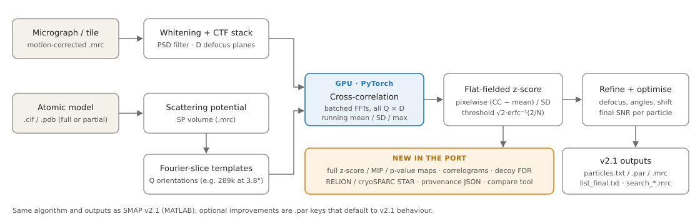
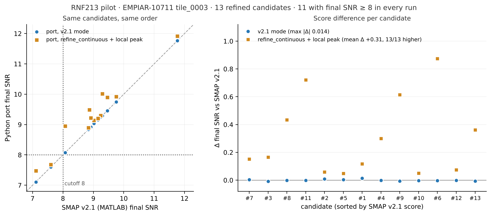
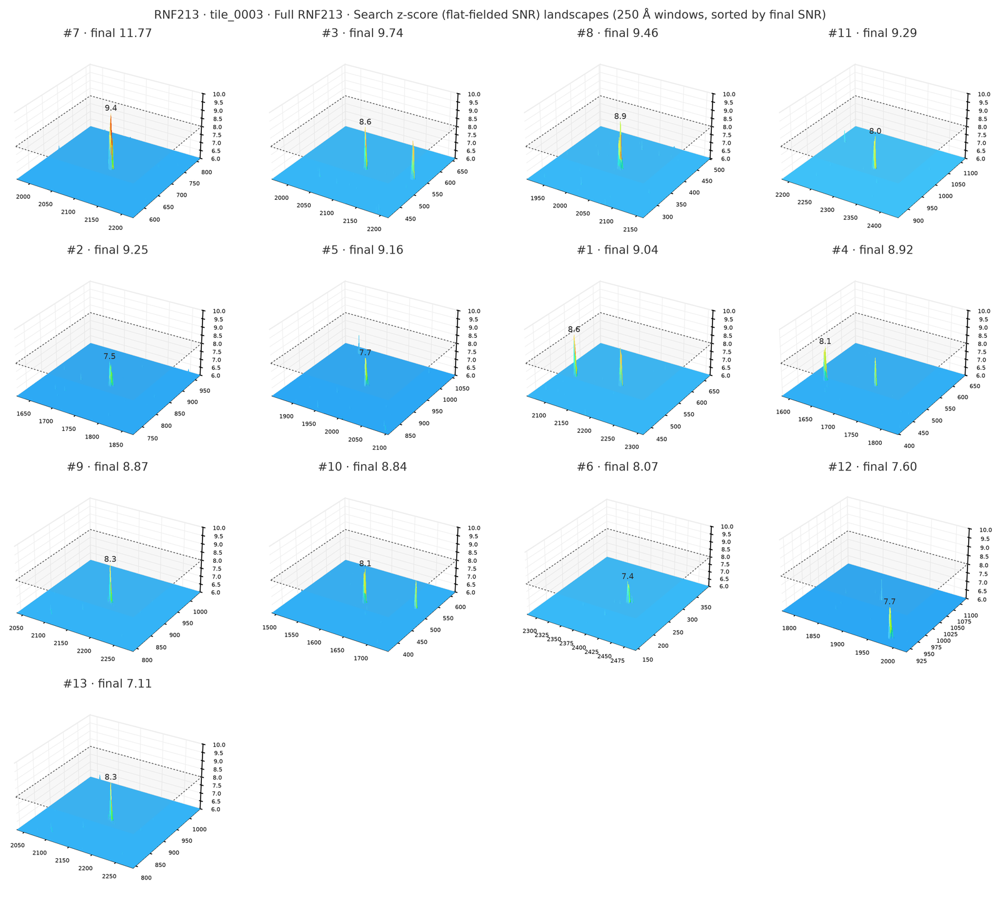
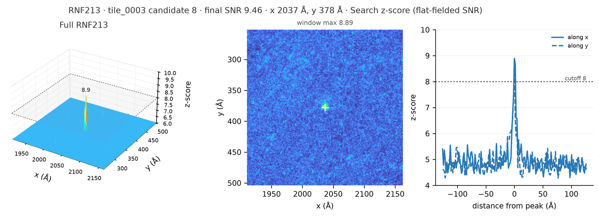
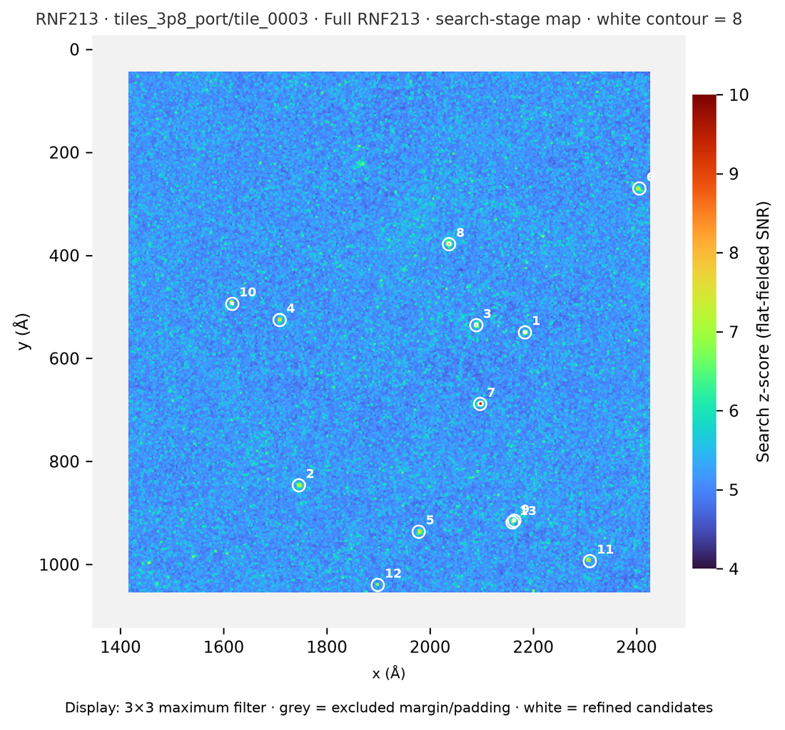
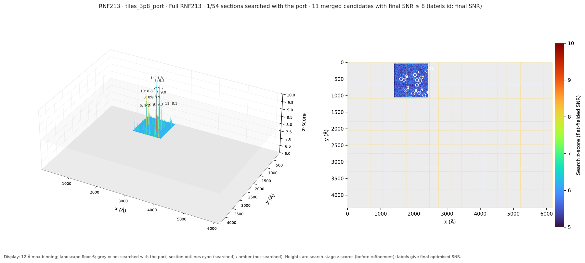

# Py_smap_v2.1

**Open-source Python/PyTorch port of SMAP v2.1 — high-resolution template matching (HRTM) for
cryo-EM images.**

[](https://github.com/drTakuOmics/Py_smap_v2.1/actions/workflows/python-tests.yml)


SMAP finds individual copies of a known macromolecule in a single 2D cryo-EM image. It compares
the image with noise-free projections of an atomic model over all orientations and several
defocus planes, and it validates every hit against the statistics of the whole search, without
2D classification or averaging. This repository translates SMAP v2.1 (J. Peter Rickgauer,
HHMI Janelia) from MATLAB to Python, with the original author's permission. It keeps the same
algorithm, `.par` files and output files.



## Why a Python port

- **Open from end to end.** v2.1 needs MATLAB or the MATLAB Runtime inside Docker. The port
  installs with `pip`; it needs no licence, no container and no `sudo`.
- **The same science, checked.** The code was translated one function at a time and compared
  with the original MATLAB code run in Octave. On real data (RNF213, below) the port finds the
  same 13 candidates as the MATLAB v2.1 run, with final scores within 0.014.
- **Runs on the GPUs you have.** PyTorch on any CUDA GPU, or on CPU, with orientations batched
  on the GPU. One 1024 × 1024 tile searched over 289,000 orientations (3.8°) took 244 s on an
  RTX 3090.
- **Readable and extensible.** Tests run in CI. Every run writes a provenance file (input
  hashes, code version, GPU). New analyses are opt-in (below); with none of them set, the
  port reproduces v2.1, including its known quirks
  ([PORT_NOTES.md](PORT_NOTES.md)).

**Added in the port** (none of these change a v2.1 output file):

- full-image z-score, MIP and p-value maps (Zhang et al., IUCrJ 2025);
- 3D peak landscapes ("correlograms");
- target–decoy FDR estimates;
- RELION/cryoSPARC STAR export;
- a tool that compares two runs;
- optional refinement improvements.

## Two kinds of data

| | In situ: cells | Purified protein: single-particle cryo-EM |
|---|---|---|
| Example | Legacy SMAP v2.1 sample: mouse embryonic fibroblast; 60S ribosomal subunit (LSU, PDB 6EK0); decoy: rearranged *E. coli* ribosome (PDB 5J5B) | **RNF213 pilot:** purified RNF213 micrographs (EMPIAR-10711); model PDB 7OIK (RNF213:UBE2L3) and partial (domain-omitted) templates |
| Folder | [`examples/ribosome_in_situ`](examples/ribosome_in_situ) | [`examples/rnf213_purified`](examples/rnf213_purified) |
| Question | Locate and orient one complex in a crowded cell | Detect ~600 kDa particles and test the port, refinement options and validation controls on a purified sample |

HRTM was developed for in situ data. In a purified sample there are many particles per image
and the ice is thin, so the RNF213 pilot is a controlled test bed before applying the same
workflow to cells.

## The `.par` file in brief

A search is described by a plain-text `.par` file with one `key value` per line; `#` starts a
comment. The essential keys:

| Key | Meaning |
|---|---|
| `function search_global` | the program to run (global 2D search) |
| `imageFile` | pre-processed (motion-corrected, summed) micrograph `.mrc` |
| `structureFile` / `modelFile` | atomic model (`.cif`/`.pdb`, converted to a scattering potential) or a potential `.mrc` |
| `outputDir` | where results go |
| `aPerPix`, `aPerPix_search` | pixel size of the image, and of the search (the image is resampled) |
| `defocus` | `df1 df2 angle` in CTFFind convention (Å, Å, degrees) |
| `V_acc`, `Cs` | acceleration voltage (V) and spherical aberration (m) |
| `angle_inc`, `psi_inc` | orientation sampling (degrees); 3.8° gives 289,000 orientations |
| `T_sample`, `df_inc` | sample thickness and defocus-plane spacing (nm) |
| `arbThr`, `optThr` | values stored for flat-fielding, and the score needed to refine a candidate |
| `nCores` | number of jobs (one per GPU) |

The upstream README ([docs/SMAP_v2.1_README.md](docs/SMAP_v2.1_README.md)) documents every key
and output file. The port's opt-in keys are listed in [PORT_NOTES.md](PORT_NOTES.md) (section "Options").

## Install

```bash
conda create -n pysmap -c conda-forge --override-channels python=3.11 -y
conda activate pysmap
pip install torch --index-url https://download.pytorch.org/whl/cu128   # match your NVIDIA driver (or /whl/cpu)
pip install -e ".[test]"
python tools/gpu_smoke.py        # same synthetic search on CUDA and CPU; prints "GPU SMOKE TEST PASSED"
pytest                           # CPU, a few minutes; no MATLAB or Octave needed
```

## Run

```bash
# legacy in situ example (the .par uses the upstream Docker paths /opt/smap/...)
python -m smap.search_global examples/ribosome_in_situ/sample_search.par \
       --path-map /opt/smap=examples/ribosome_in_situ --output-dir results/ribosome \
       --batch-size 8 --log results/ribosome_run.log

# compare two runs (MATLAB v2.1 vs port, CPU vs GPU, option A vs B)
python -m smap.compare results/run_a results/run_b --json compare.json
```

The decoy for the ribosome example is in the same folder (`model/5j5b_monster.pdb`). Run it the
same way with `modelFile` set to that file, then compare score distributions with
`python -m smap.decoy`.

## Example: RNF213 pilot (purified, single-particle micrographs)

Micrographs (4092 × 5760 px, 1.072 Å/px) were cut into 1024² tiles. Each tile was searched
with the full RNF213:UBE2L3 template (7OIK) and, for validation, with a partial template in
which the E3 module was omitted. The workflow scripts, commands and the tile runner for the
port are in [examples/rnf213_purified](examples/rnf213_purified).

**1. The port reproduces SMAP v2.1 on real data.** On tile 0003 both find the same 13
candidates in the same order, 11 of them with final SNR ≥ 8. Final scores differ by at most
0.014 (blue). With the optional refinement (`refine_continuous 1`, `refine_local_peak 20`,
ochre) every score rises, by +0.31 on average. Some of that rise is expected even for noise,
because more parameters are fitted, so the cutoff for this mode has to be set with a decoy.



**2. The full z-score map is now available.** v2.1 stored scores only above `arbThr`. The port
writes the whole map, so every candidate can be shown as a 3D peak landscape (the per-pixel
z-score at the search stage, before refinement):



| One candidate: peak, top view and profiles | Whole tile with the cutoff-8 contour |
|---|---|
|  |  |

All searched tiles of a micrograph can be stitched into one landscape (shown with one of 54
tiles searched so far):



**3. Validation controls.**

- A mirror-image (enantiomer) template is **not** a decoy for 2D searches. Every projection of
  the mirrored model equals a projection of the original at another orientation, so handedness
  is invisible in a single projection. The repository's tests confirm this numerically, and
  the mirror search of tile 0003 found the same particles again (final SNR 8.7–11.7).
  Enantiomer controls stay valid for 3D searches in reconstructions or tomograms.
- A decoy is a **different structure of comparable mass and resolution** that cannot be in the
  sample, as in Rickgauer et al. 2024, where an *E. coli* ribosome was the decoy for mammalian
  LSU searches. `tools/make_decoy_model.py` trims a candidate decoy (e.g. a dynein motor
  domain) to the searched template's atom count and shape. It also reports truncated side
  chains, which would weaken the decoy.
- Identity is tested with **omitted-domain (anchor) searches**: particles found with the
  E3-omitted template are reconstructed and checked for the omitted density. The same 21-image
  anchor batch is being re-run with the port for a side-by-side comparison with v2.1.

## Repository layout

| Path | Contents |
|---|---|
| `smap/` | the port: `search_global` (setup, GPU search, combine, CLI), `refine` (clustering, refinement, optimisation, output files), `structure` (atomic model → scattering potential), `ctf`, `grid`, `rot`, `io`, `utils`, `stats`; new: `compare`, `decoy`, `export`, `pvalue`, `provenance` |
| `examples/ribosome_in_situ/` | upstream SMAP v2.1 sample: image, LSU target, ribosome decoy, rotations, `sample_search.par` |
| `examples/rnf213_purified/` | RNF213 pilot: commands, results tables |
| `tools/` | `gpu_smoke.py`, `make_decoy_model.py`, `gen_sf_table.py`; `tools/rnf213/`: tile runner, correlograms, micrograph landscape |
| `tests/` | Octave-parity tests (references generated from the original MATLAB code), synthetic end-to-end, CLI and tool tests |
| `experiments/` | small numerical studies behind the optional improvements |
| `docs/` | upstream SMAP v2.1 README, figures |
| [`PORT_NOTES.md`](PORT_NOTES.md) | technical notes: status, flags, options, outputs, tests, 17 v2.1 behaviours found during the port |

## Citing

If you use this software, please cite the original method and software:

- Rickgauer J.P., Choi H., Moore A.S., Denk W., Lippincott-Schwartz J. Structural dynamics of
  human ribosomes in situ reconstructed by exhaustive high-resolution template matching.
  *Mol. Cell* 84, 4912–4928 (2024). [doi:10.1016/j.molcel.2024.11.003](https://doi.org/10.1016/j.molcel.2024.11.003).
  SMAP v2.1 version of record: [doi:10.5281/zenodo.13994274](https://doi.org/10.5281/zenodo.13994274).
- Rickgauer J.P., Grigorieff N., Denk W. Single-protein detection in crowded molecular
  environments in cryo-EM images. *eLife* 6, e25648 (2017). [doi:10.7554/eLife.25648](https://doi.org/10.7554/eLife.25648).

and, when you use the p-value maps: Zhang K. et al., *IUCrJ* 12 (2025)
([eh5020](https://journals.iucr.org/m/issues/2025/02/00/eh5020/)).

RNF213 example data: EMPIAR-10711; model PDB 7OIK (Ahel J. et al.).

## License

MIT. The original SMAP v2.1 copyright notice is kept in [LICENSE](LICENSE).
