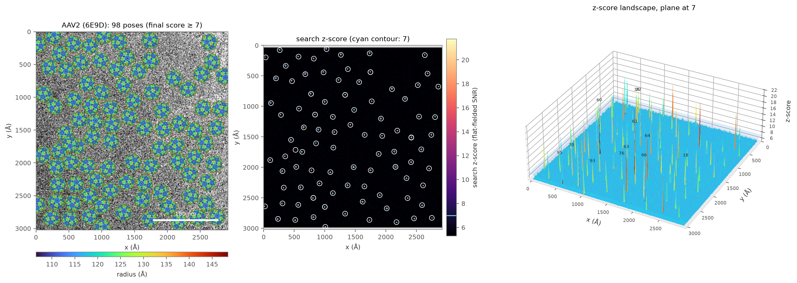
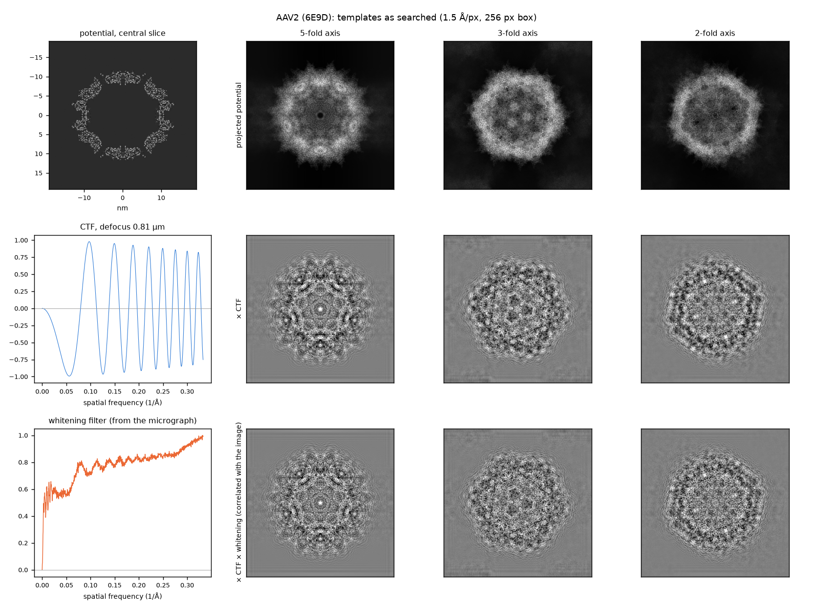
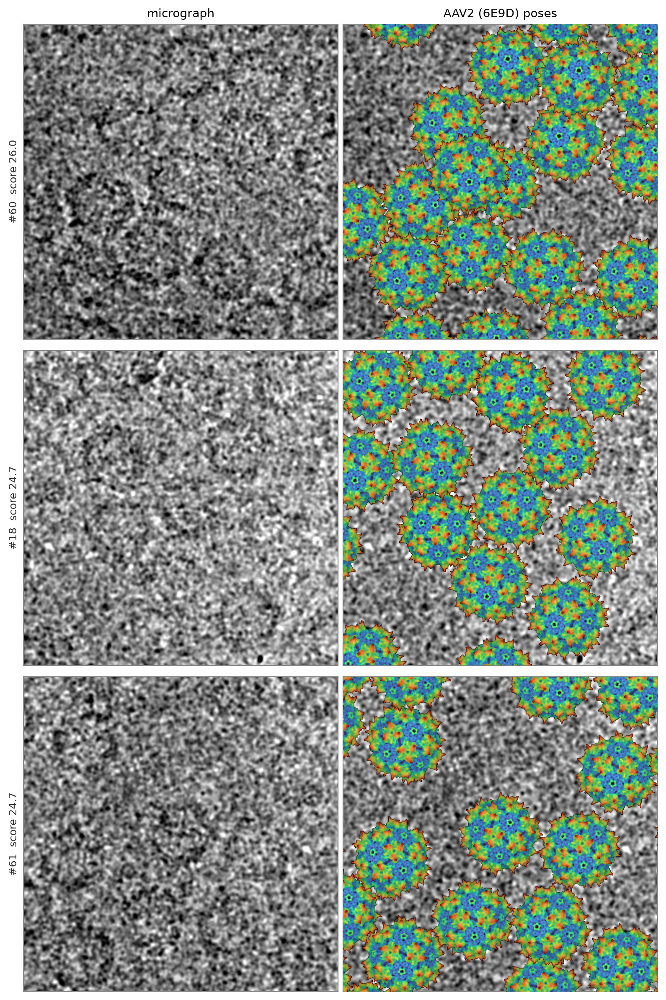

# AAV2 capsid (EMPIAR-10202): icosahedral search on purified virus-like particles

Search for the adeno-associated virus serotype 2 capsid (variant L336C, empty virus-like particles;
60 subunits, 250 Å diameter) in the micrographs of EMPIAR-10202 (Tan et al., Nat Commun 2018), with
the angular grid reduced to one asymmetric unit of the icosahedral group (`symmetryFile`). The
authors' final particle list (a RELION STAR file with refined coordinates, angles and per-particle
CTF) gives the CTF of each micrograph and serves as a positive control.



*One micrograph (61 particles in the published list): the 98 detected capsids rendered at their
refined poses and coloured by radius (left), the search z-score map (middle) and the z-score
landscape (right).*

Run everything from the repository folder; data and results go to a working folder:

```
export AAV=/path/to/aav2_empiar10202
cd /path/to/Py_smap_v2.1
```

## Data and template

| Item | Source |
|---|---|
| Micrographs | EMPIAR-10202, `03_MotionCor2_Bin2_DW_Aligned_Micrograph`: gain- and motion-corrected (MotionCor2), dose-weighted, magnification anisotropy corrected, Fourier-binned to 0.788 Å/px; 3710 × 3838 px, 57 MB each |
| Particle list | EMPIAR-10202, `06_Final_Stack`: only the STAR file (30,515 particles on 1159 micrographs). The particle stack in the same folder (~78 GB) is not needed. |
| Model | PDB 6E9D (60 chains, 1.86 Å). Only ATOM records are read, so the ordered waters of the model are not part of the template. |
| Microscope | 300 kV, Cs 2.7 mm (from the STAR file) |

These micrographs already have the preprocessing a 2DTM search expects (gain correction, motion
correction, exposure weighting, binning of super-resolution pixels). Whitening, central-cross
masking and normalisation are done by the search (`psdFilterFlag`, `maskCrossFlag`, defaults 1).

Search settings (`aav2_capsid.par`): 1.5 Å/px search sampling, 1.88° angular step (38,200 of about
2.3 M orientations after the icosahedral reduction), 5 defocus planes over 80 nm around each
micrograph's defocus, refinement of candidates with search score ≥ 7. The spread of particle defocus
within a micrograph (median 43 nm, 70 nm on the most crowded ones) sets `T_sample`.

## Steps

**1. Particle list and model** (the STAR file is about 12 MB, the model about 54 MB):

```
mkdir -p $AAV/micrographs $AAV/models $AAV/meta
wget -q -r -nd -np -A "*.star" -P $AAV/meta ftp://ftp.ebi.ac.uk/empiar/world_availability/10202/data/06_Final_Stack/
wget -q -P $AAV/models https://files.rcsb.org/download/6E9D.cif.gz && gunzip -f $AAV/models/6E9D.cif.gz
```

**2. Symmetry operators.** 6E9D deposits the whole capsid and lists only the identity operator, so the
60 rotations are derived by superposing the chains, then checked against the same model:

```
python -m smap.symmetry $AAV/models/6E9D.cif --from-chains --assembly $AAV/models/6E9D.cif --out $AAV/models/6E9D_I.txt
```

Expected: 60 rotations (I), chain rmsd and assembly-check distance close to 0 Å.

**3. One `.par` per micrograph from the STAR file** (median defocus of the micrograph's particles;
voltage and Cs from the file), the particle list of each micrograph (`coords/`, centre = coordinate
minus the refined origin shift) and the download links. File names in the STAR file refer to the
frames 5–19 sums; `--rename` maps them to the dose-weighted sums. `--top 2`: the two micrographs with
the most particles.

```
STAR=$AAV/meta/2017-12-27_MagCorrect_Frames05-19_Numbered_adjusted.star
URL=ftp://ftp.ebi.ac.uk/empiar/world_availability/10202/data/03_MotionCor2_Bin2_DW_Aligned_Micrograph
python tools/star_to_pars.py $STAR --template examples/aav2_capsid/aav2_capsid.par --micrograph-dir $AAV/micrographs --out-dir $AAV/pars --results-dir $AAV/results --top 2 --rename '_st_Stk_corrected\.mrc$=-a-DW_magcorrect.mrc' --url-prefix $URL --set structureFile=$AAV/models/6E9D.cif --set symmetryFile=$AAV/models/6E9D_I.txt
wget -q -nc -P $AAV/micrographs -i $AAV/pars/download_urls.txt
```

**4. Checks before the search** (minutes): the CTF against the Thon rings, a short probe search (it
computes the template potential once and times the search) and the pixel size against the scale of
the model:

```
for p in $(cat $AAV/pars/jobs.txt); do python tools/ctf_check.py $p; done
P=$(head -1 $AAV/pars/jobs.txt)
python -m smap.search_global $P --output-dir $AAV/probe --max-rotations 2000 --no-refine --allow-incomplete --batch-size 8
python tools/radial_scan.py $AAV/probe --fine --out $AAV/radial
```

Results on the first micrograph: `ctf_check` best mean-defocus offset 0 and +100 Å on the two
micrographs (their astigmatism, 100–140 Å, is too small to test the angle convention);
`radial_scan` 0.7887 Å against the given 0.788 Å, normal contrast. At 0.8 µm defocus the rotationally
averaged template does not separate single capsids (the calibration is marked not reliable), but the
pixel-size curve still peaks at 0.788 Å.

**5. Search.** Point the `.par` files at the potential computed by the probe, so that it is not
computed again in every search, then run the first micrograph (about 3.5 min of search; refinement of
the candidates takes most of the run time):

```
SP=$(ls $AAV/probe/*_SP.mrc)
python tools/star_to_pars.py $STAR --template examples/aav2_capsid/aav2_capsid.par --micrograph-dir $AAV/micrographs --out-dir $AAV/pars --results-dir $AAV/results --top 2 --rename '_st_Stk_corrected\.mrc$=-a-DW_magcorrect.mrc' --set structureFile=$SP --set symmetryFile=$AAV/models/6E9D_I.txt
nohup python -u -m smap.search_global $P --batch-size 8 > $AAV/search1.log 2>&1 &
tail -f $AAV/search1.log
```

**6. Comparison with the published particles and figures:**

```
R=$AAV/results/$(basename $P .par)
C=$(python -c "import json; print(round(json.load(open('$R/search_status.json'))['gaussian_threshold'], 2))")
python tools/match_positions.py $R $AAV/pars/coords/$(basename $R).csv
python tools/search_figures.py $R --cutoff $C --volume $SP --label "AAV2 (6E9D)" --color-by radial --out $AAV/figures/$(basename $R)
```

**7. What the search compares** (CPU, about a minute): the templates of this search along a 5-, 3- and
2-fold axis, before and after the CTF and the whitening filter, from the search's own setup:

```
python tools/template_views.py $P --label "AAV2 (6E9D)" --out $AAV/figures/template_views.png
```

**8. More micrographs** (resumable queue; `--top 50`: the 50 micrographs with the most particles):

```
python tools/star_to_pars.py $STAR --template examples/aav2_capsid/aav2_capsid.par --micrograph-dir $AAV/micrographs --out-dir $AAV/pars50 --results-dir $AAV/results --top 50 --rename '_st_Stk_corrected\.mrc$=-a-DW_magcorrect.mrc' --url-prefix $URL --set structureFile=$SP --set symmetryFile=$AAV/models/6E9D_I.txt
nohup bash -c "wget -q -nc -P $AAV/micrographs -i $AAV/pars50/download_urls.txt; BATCH=8 bash examples/decolace_tric/run_queue.sh $AAV/pars50/jobs.txt" > $AAV/batch50.log 2>&1 &
```

## What the search compares



For every orientation of the reduced grid the search projects the potential (top row), multiplies
the projection by the CTF of each defocus plane (middle row: contrast inverted and fringes from the
oscillating CTF) and by the whitening filter computed from the micrograph's own spectrum (bottom row:
noise flattened across frequencies, which raises the weight of high-resolution detail), normalises it
and cross-correlates it with the whitened micrograph. At each pixel, the maximum over orientations and
defocus planes, minus the mean and divided by the standard deviation of all correlation values at
that pixel, is the z-score map of the summary figure. A capsid seen along a symmetry axis shows that symmetry in its projection; with the
icosahedral reduction each distinct projection is computed once (38,200 orientations instead of
about 2.3 M).

## Results (first micrograph)

Micrograph `17aug31d_00001sq_v01_00002hl_00007ed3`, 61 particles in the published list; search cutoff
7.0 (one false positive per image).

| | |
|---|---|
| Orientations | 38,200 (1.88°, icosahedral reduction); 5.5 ms each on one RTX 3090 |
| Refined candidates | 98, final scores 7.6–26.0 (96 above 10) |
| Published particles found | 61 of 61 at every cutoff from 7 to 10 |
| Detections not in the published list | 37 (35 above 10) |
| Position difference to the published centres | 0.0 / −0.1 Å (x / y), SD 0.1 / 0.2 Å |

The detections outside the published list are almost all far above the cutoff: capsids that were not
kept in the published particle set (78,194 picked, 30,515 kept after 2D classification and score
filtering). Two of them (7.6 and 8.3) are close to the cutoff.



## Files

| File | Purpose |
|---|---|
| `aav2_capsid.par` | common search settings |
| `results/figures/summary.png`, `poses_pairs.png`, `zmap.png` | figures of the first micrograph (`tools/search_figures.py --color-by radial`) |
| `results/figures/template_views.png` | templates along the symmetry axes, as searched (`tools/template_views.py`) |
| `results/match_00007ed3.csv` | every detection of the first micrograph with its paired published particle and distance |

Tools used: `smap.symmetry --from-chains`, `tools/star_to_pars.py`, `tools/ctf_check.py`,
`tools/radial_scan.py`, `tools/match_positions.py`, `tools/search_figures.py`, `tools/template_views.py`. Problems and fixes:
[`docs/FAQ.md`](../../docs/FAQ.md).

## References

- Tan YZ, Aiyer S, Mietzsch M, et al. Sub-2 Å Ewald curvature corrected structure of an AAV2 capsid
  variant. *Nat Commun* 9, 3628 (2018). https://doi.org/10.1038/s41467-018-06076-6
- EMPIAR-10202 (images and particles), EMD-9012 (map), PDB 6E9D (model).
