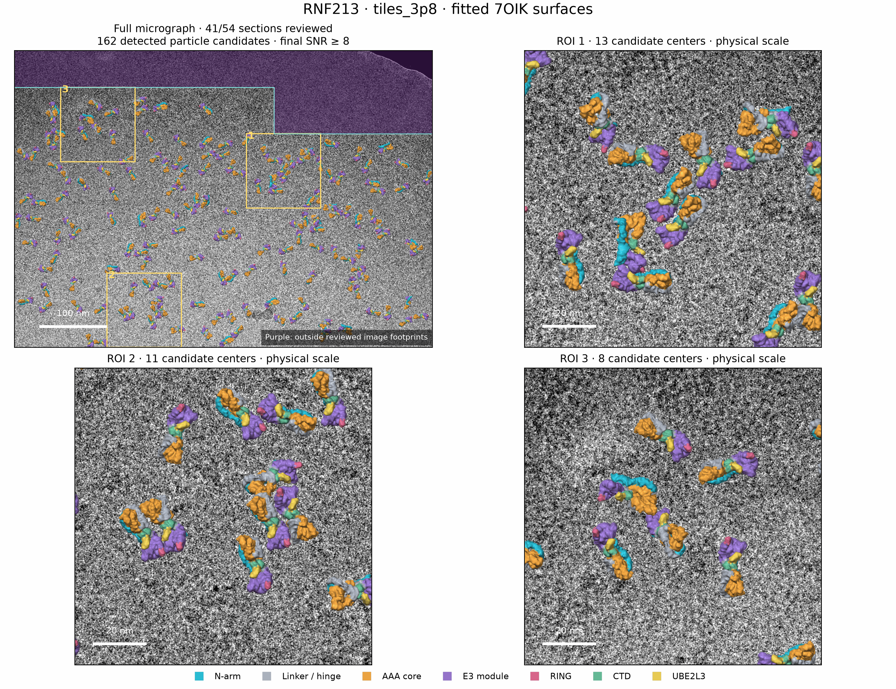
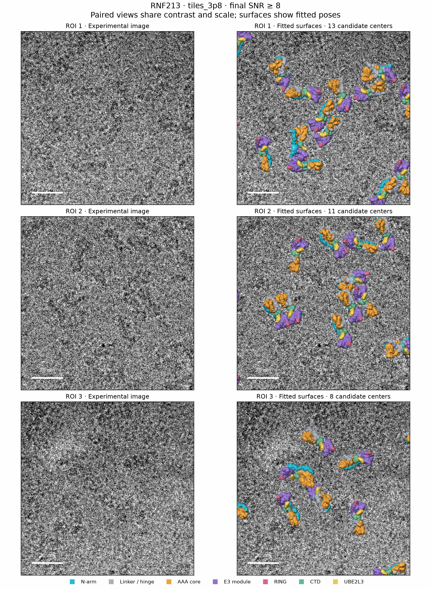
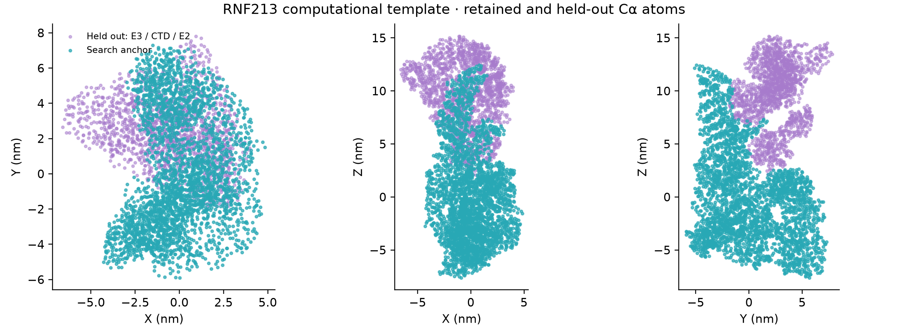
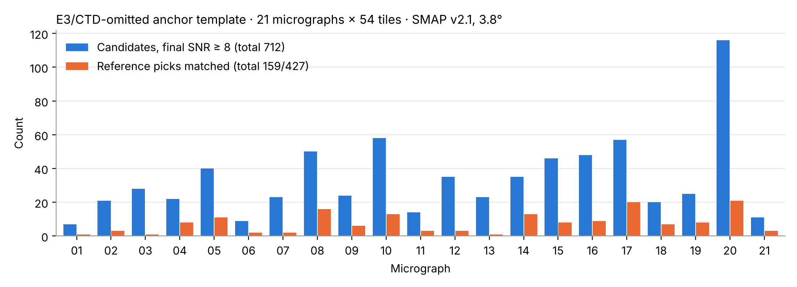
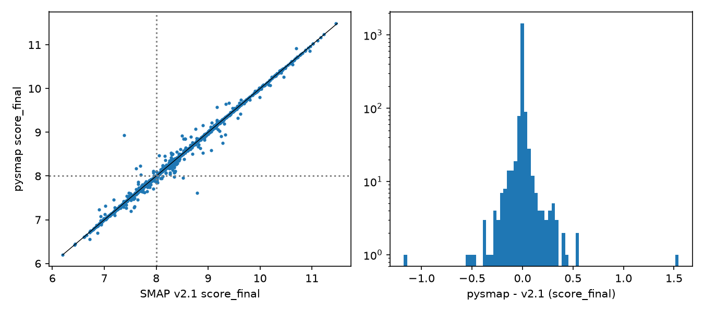

# RNF213 pilot: HRTM on purified single-particle micrographs

**What this is.** A pilot of 2D high-resolution template matching on cryo-EM micrographs of
*purified* RNF213 (EMPIAR-10711, 4092 × 5760 px, 1.072 Å/px), not on cells. The full template is
the RNF213:UBE2L3 model (PDB 7OIK); partial templates (domain-omitted "anchors", spherical
fragments) test whether detections recover density that the template did not contain. Reference
picks (`refined_particles.star`) from the single-particle analysis are used only to count
positional matches. Results are in [results/](results) and in the main [README](../../README.md).

**Scripts.** The workflow scripts are in [scripts/](scripts): pilot and anchor preparation
(`rnf213_smap_pilot.py`, `rnf213_anchor_prepare.py`), tile registration and review
(`rnf213_workflow_v3.py`, `rnf213_review.py`), batch planning, running and review
(`rnf213_batch_*.py`, `rnf213_finalize_batch.py`) and the surface overlays
(`rnf213_surface_overlay.py`). They read SMAP v2.1 and pysmap outputs alike. The port's tile
runner and plots are in [tools/rnf213/](../../tools/rnf213). v2.1 tile trees are never modified.

## Install (once)

```bash
git clone https://github.com/drTakuOmics/Py_smap_v2.1.git      # or: git -C Py_smap_v2.1 pull
conda create -n pysmap -c conda-forge --override-channels python=3.11 -y && conda activate pysmap
pip install torch --index-url https://download.pytorch.org/whl/cu128   # driver 570 / CUDA 12.8
pip install -e "Py_smap_v2.1[test]"
python Py_smap_v2.1/tools/gpu_smoke.py        # CUDA vs CPU on a synthetic tile; must print PASSED
```

The commands below run from the project folder (micrographs and tile trees; `/work` in the
v2.1 Docker runs) and use two variables:

```bash
export PROJECT=/path/to/rnf213_project PYSMAP=/path/to/Py_smap_v2.1
cd "$PROJECT"
T=$PYSMAP/tools/rnf213/rnf213_port_tiles.py; S=$PYSMAP/examples/rnf213_purified/scripts
```

## Workflow recap

SMAP v2.1 (Docker) on an RTX 3090; 1.072 Å/px micrographs searched at 1.5 Å/px, each cut into
54 overlapping 1024² tiles (640 px stride). Detection = final flat-fielded SNR ≥ 8, duplicates
merged within 20 px. Reference picks from the single-particle analysis are selected, not
exhaustive: they count positional matches (≤ 20 px), and unmatched candidates are not
automatically false. Orientations are not independently validated.

### 1. Pilot: one micrograph, three angular steps (full 7OIK template)



All 162 detections of the 3.8° search drawn as the 7OIK surface at the fitted pose, at physical
scale; purple = tiles not in the three-run comparison. ROIs 1–3 are enlarged below.



Experimental image (left) and fitted surfaces (right), same contrast and scale (~0.95 figure px
per micrograph px; click for full size). Eight detections with different fitted rotations:
[pilot_orientation_gallery_3p8.png](results/figures/pilot_orientation_gallery_3p8.png).
Figures from `rnf213_surface_overlay.py` (rotation convention checked against SMAP templates).

| Angular step | Orientations | Min per tile | GPU h (tiles done) | Detections | Reference picks matched |
|---|---|---|---|---|---|
| 5.0° | 126,864 | 6.2 | 5.6 (54/54) | 137 | 35/54 (64.8%) |
| 3.8° | 288,990 | 12.5 | 11.1 (53/54) | 162 | 38/54 (70.4%) |
| 1.8° | 2,593,766 | 104 | 73.3 (42/54) | 179 | 42/54 (77.8%) |

Counts are for the 41 tiles completed in all three runs; accumulation per tile:
[pilot_cumulative_by_angle.png](results/figures/pilot_cumulative_by_angle.png),
table: [pilot_angles.csv](results/tables/pilot_angles.csv). From 3.8° to 1.8°: +17 detections
and +4 matches for 8.3× the time per tile. The searches below use 3.8°.

### 2. Partial (anchor) template and a 21-micrograph batch



The anchor is 7OIK chain A without the E3 module (residues 3589–4926), the CTD (4927–5148) and
UBE2L3: 326 of 491 kDa. Density for the held-out parts in detected particles was then not in
the template (alignment bias still applies). On the pilot tile 3 (3.8°) the full template gives
13 refined candidates (11 ≥ 8) and the anchor 5 (4 ≥ 8); all 4 coincide with full-template
detections (≤ 2.3 px, ≤ 4.4°) ([anchor_pilot_tile0003.csv](results/tables/anchor_pilot_tile0003.csv)).



| Batch (anchor, 3.8°) | |
|---|---|
| Micrographs × tiles | 21 × 54 = 1,134 |
| Tile entries with SNR ≥ 8 | 1,343 |
| Candidates after overlap removal | 712 (7–116 per micrograph) |
| Reference picks matched | 159/427 (37.2%) |

Per micrograph: [batch21_per_image.csv](results/tables/batch21_per_image.csv).

### 3. Port check: pysmap vs SMAP v2.1 on the same tiles



The anchor batch was searched again with pysmap (same `search.par` per tile, same GPU) and
compared tile by tile with `rnf213_port_tiles.py compare` on the 1,027 tiles searched by both
(micrographs 1–19 and one tile of micrograph 20). This checks the port; it is not a new result.

| | SMAP v2.1 | pysmap |
|---|---|---|
| Refined candidates | 1,793 | 1,792 |
| Paired | 1,763 | 1,763 |
| Tile entries with SNR ≥ 8 | 1,106 | 1,098 |
| Candidates after overlap removal (micrographs 1–19) | 585 | 582 |
| Reference picks matched (micrographs 1–19) | 135 | 134 |
| Wall time per tile, median | 756 s | 254 s |
| GPU hours, all 1,027 tiles | 236.5 | 72.2 |

On the same RTX 3090 and the same tiles, pysmap (`--batch-size 8`) used about 3.3× less GPU time than SMAP v2.1 (wall time including start-up).

Final SNR, pysmap − v2.1 (1,763 pairs): mean −0.0006, SD 0.075, median 0.000, r = 0.996;
30 candidates are v2.1-only and 29 pysmap-only. The search mean and SD maps differ by ≤ 0.0014
and ≤ 0.0009, and search-stage scores by ≤ 0.057, consistent with float summation order; the
map differences alone fail the strict map tolerance of `smap.compare` on every tile.

Refined angles agree within 0.1° for every pair in 562 of the 714 tiles with paired candidates.
In 150 tiles at least one pair ends one refinement step or more apart (≥ 0.45°; step 0.5°).
All 41 pairs with |Δ final SNR| > 0.2 are of this kind: 33 also differ in defocus (≥ 3 nm),
13 start from grid peaks 1 px apart, and 7 cross the cutoff of 8. The largest
(micrograph 13, tile 51: 7.39 → 8.93) ends 4.9° and 45.5 nm apart.
Tables: [port_vs_v21_summary.csv](results/tables/port_vs_v21_summary.csv),
[port_vs_v21_pairs_summary.json](results/tables/port_vs_v21_pairs_summary.json), pairs with
|Δ| > 0.2: [port_vs_v21_large_delta_pairs.csv](results/tables/port_vs_v21_large_delta_pairs.csv).

## Results so far

| Run | Tile 0003 (3.8°, full template) |
|---|---|
| SMAP v2.1 (MATLAB, Docker) | 13 refined candidates, 11 with final SNR ≥ 8 |
| Port, v2.1 mode | same 13 candidates, max \|Δ final SNR\| 0.014, 244 s on an RTX 3090 |
| Port, `refine_continuous 1` + `refine_local_peak 20` | same 13, all higher (mean +0.31), 11 ≥ 8, 371 s |

Scores per candidate: [results/tile0003_final_scores.csv](results/tile0003_final_scores.csv).
The 21-image anchor batch and the port check on it are in [Workflow recap](#workflow-recap).

## One tile, v2.1 mode and improved mode

```bash
python $T prepare --source tiles_3p8 --dest tiles_3p8_port
python $T prepare --source tiles_3p8 --dest tiles_3p8_plus --set refine_continuous=1 --set refine_local_peak=20
python $T run --tiles tiles_3p8_port --only tile_0003 --device cuda
python $T run --tiles tiles_3p8_plus --only tile_0003 --device cuda
python $T compare --a tiles_3p8 --b tiles_3p8_port      # v2.1 vs port (should agree)
python $T compare --a tiles_3p8 --b tiles_3p8_plus      # v2.1 vs improved
```

`prepare` rewrites only `imageFile`/`outputDir` (same `/work/...` style), hard-links the tile
images, checks that every referenced input exists and rejects unknown `--set` keys.
`run` calls `python -m smap.search_global <tile>/search.par --path-map /work=<project>
--log <tile>/run.log`, skips completed tiles with the same rule as
`rnf213_batch_workflow.py`, archives unfinished attempts under `<tile>/attempts/` and
writes `run_state.json` (elapsed seconds). `compare` runs `smap.compare` per tile and writes
`<b>/review/compare_vs_<a>/per_tile.csv`.

## Whole tree and the review scripts

```bash
python $T run --tiles tiles_3p8_port --device cuda
python $S/rnf213_workflow_v3.py --tiles tiles_3p8_port --reference refined_particles.star --out tiles_3p8_port/review/merged
python $S/rnf213_review.py --runs tiles_3p8 tiles_3p8_port --archive-old-reviews
```

`rnf213_review.py` publishes to `review_current` in the project folder; `--archive-old-reviews`
keeps the previous review instead of replacing it. `rnf213_surface_overlay.py` writes the
overlay figures to `review_current/overlays/<run>/`.

Batches: `prepare --source <batch>/searches --dest <batch>_port/searches` copies the batch
metadata and re-points `jobs.csv`, so `rnf213_batch_review.py --batch <batch>_port --out
<batch>_port/review` reads the port outputs. Each tile keeps its own `search.par`, so an anchor
batch is searched with the same anchor model. `run --images image_0001 image_0002` restricts a
run to some micrographs. The batch review needs every listed tile complete: to review a batch
stopped early, keep the finished micrographs in `searches/jobs.csv` (save the full list first).

## Z-score correlograms (2DTM / HRTM style)

```bash
python $PYSMAP/tools/rnf213/rnf213_correlogram.py --tile tiles_3p8_port/tile_0003 \
       --reference refined_particles.star --out figures/correlogram_tile0003
# full vs partial template on the same region (shared z scale):
python $PYSMAP/tools/rnf213/rnf213_correlogram.py --tile tiles_3p8_port/tile_0003 \
       --compare <partial-template port tile> --compare-label "E3/CTD-omitted anchor" --out figures/corr_full_vs_anchor
```

Overview (tile top view), one figure per candidate (3-D landscape, top view with the cutoff
contour, x/y profiles), a gallery of all candidates, `candidates.csv`; PNG/PDF/SVG + JSON.

Whole micrograph in one 3-D space (all port-searched tiles stitched, candidates merged across
overlaps within 20 px and labelled "id: final SNR"; tiles not searched with the port are grey).
`--tree` is any folder with `tile_offsets.csv`, e.g. one micrograph of a port batch:

```bash
python $PYSMAP/tools/rnf213/rnf213_landscape.py --tree <batch>_port/searches/image_0003 \
       --label "E3/CTD-omitted anchor" --out figures/landscape_image0003
```
